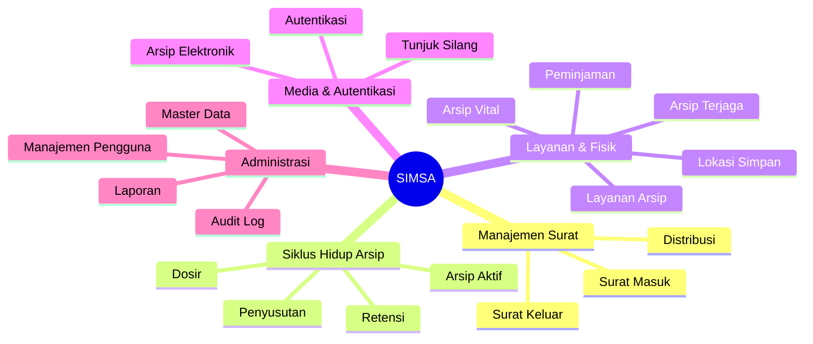
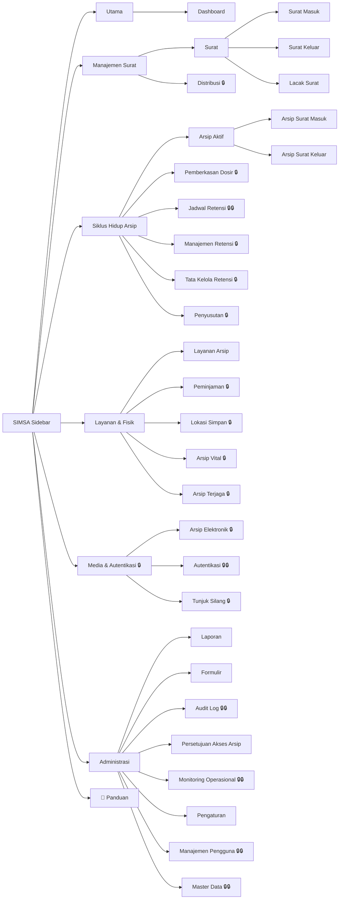
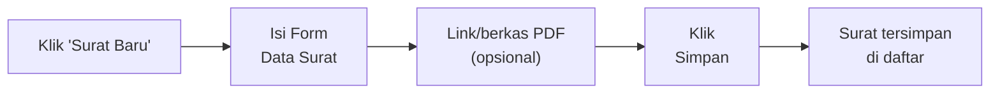
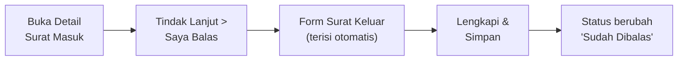
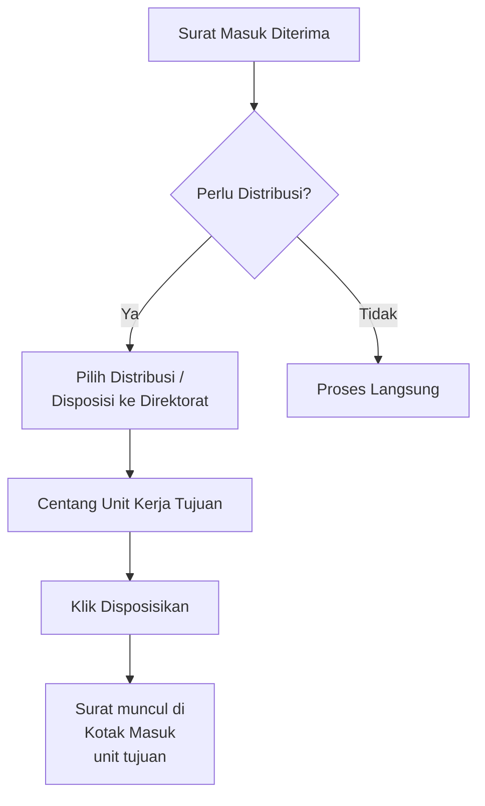
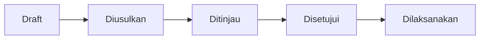
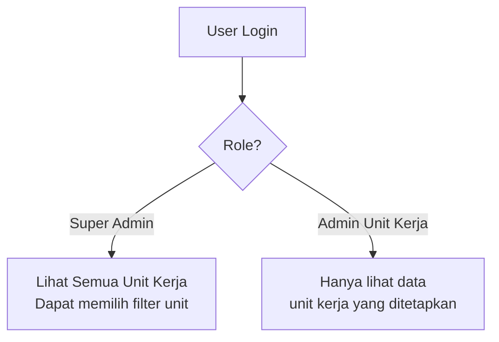
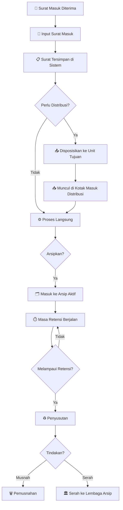
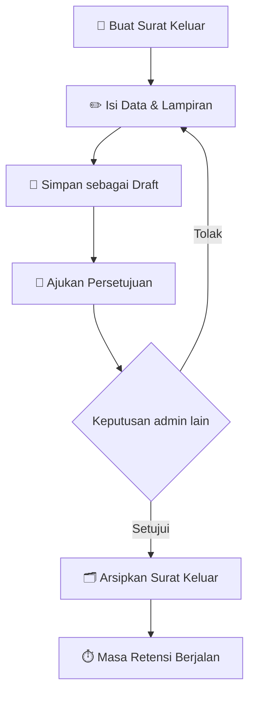

# 📘 Buku Panduan Penggunaan Aplikasi SIMSA

**Sistem Informasi Manajemen Surat & Arsip**
*Kementerian ATR/BPN — Dirjen PTPP*

> Versi 1.2.0 (BETA) | Terakhir diperbarui: 13 November 2026

---

## Daftar Isi

1. [Pendahuluan](#1-pendahuluan)
2. [Login](#2-login)
3. [Dashboard](#3-dashboard)
4. [Navigasi Sidebar](#4-navigasi-sidebar)
5. [Manajemen Surat](#5-manajemen-surat)
   - 5.1 Surat Masuk
   - 5.2 Surat Keluar
   - 5.3 Distribusi Surat
   - 5.4 Rangkaian Surat & Lacak Surat
   - 5.5 Berkas Rangkaian, Koreksi Berkas & Data Lama
   - 5.6 Perlu Dilengkapi
6. [Siklus Hidup Arsip](#6-siklus-hidup-arsip)
   - 6.1 Arsip Aktif
   - 6.2 Pemberkasan (Dosir)
   - 6.3 Jadwal Retensi Arsip
   - 6.4 Manajemen Retensi
   - 6.5 Penyusutan Arsip
7. [Layanan & Fisik](#7-layanan--fisik)
   - 7.1 Layanan Arsip
   - 7.2 Peminjaman Arsip
   - 7.3 Lokasi Simpan
   - 7.4 Arsip Vital
   - 7.5 Arsip Terjaga
8. [Media & Autentikasi](#8-media--autentikasi)
   - 8.1 Arsip Elektronik
   - 8.2 Autentikasi Arsip
   - 8.3 Tunjuk Silang
9. [Administrasi](#9-administrasi)
   - 9.1 Laporan
   - 9.2 Audit Log
   - 9.3 Manajemen Pengguna
   - 9.4 Master Data
   - 9.5 Pengaturan
   - 9.6 Persetujuan Akses Arsip
10. [Hak Akses Berdasarkan Role](#10-hak-akses-berdasarkan-role)
11. [Notifikasi & Fitur Tambahan](#11-notifikasi--fitur-tambahan)

---

## 1. Pendahuluan

**SIMSA** (Sistem Informasi Manajemen Surat & Arsip) adalah aplikasi web yang dirancang untuk mengelola surat masuk, surat keluar, dan arsip di lingkungan **Kementerian Agraria dan Tata Ruang / Badan Pertanahan Nasional (ATR/BPN)**, khususnya **Direktorat Jenderal Pengadaan Tanah dan Pengembangan Pertanahan (PTPP)**.

### Fitur Utama SIMSA



### Persyaratan Sistem

| Komponen | Minimum |
|----------|---------|
| Browser | Google Chrome 90+, Firefox 90+, Edge 90+ |
| Koneksi Internet | Stabil (minimal 1 Mbps) |
| Resolusi Layar | 1024 × 768 (direkomendasikan 1920 × 1080) |

---

## 2. Login

Halaman login adalah halaman pertama yang Anda lihat saat mengakses SIMSA di `https://simsa-frontend.vercel.app/`.

> [!IMPORTANT]
> SIMSA adalah sistem internal pemerintah. **Pendaftaran akun baru tidak tersedia secara publik.** Akun pengguna dibuat oleh **Super Admin** melalui menu [Manajemen Pengguna](#93-manajemen-pengguna), lengkap dengan email dan kata sandi. Hubungi Super Admin jika belum memiliki akun.

### 2.1 Tampilan Halaman Login

Halaman login menampilkan **logo SIMSA**, nama aplikasi, dan keterangan "Ditjen PTPP".

Halaman login terdiri dari:

```
┌─────────────────────────────────────────────┐
│                                             │
│        🏛️ Logo SIMSA   SIMSA                │
│                        Ditjen PTPP          │
│                                             │
│  Masukkan email dan kata sandi yang         │
│  diberikan administrator.                   │
│                                             │
│  Email kedinasan: [nama@atrbpn.go.id   ]    │
│  Kata sandi:      [________________] 👁     │
│  Lupa kata sandi? Hubungi Super Admin       │
│  untuk mengatur ulang kata sandi Anda.      │
│                                             │
│              [ Masuk ]                      │
│                                             │
│  ──────────────── atau ────────────────     │
│        [ Masuk dengan Google ]              │
│  (hanya tampil bila login Google aktif)     │
│                                             │
│  📖 Panduan pengguna                        │
│  © Kementerian ATR/BPN                      │
└─────────────────────────────────────────────┘
```

### 2.2 Cara Login

> [!IMPORTANT]
> Anda memerlukan akun yang sudah dibuat oleh Super Admin untuk bisa masuk ke SIMSA.

**Menggunakan Email dan Kata Sandi:**

1. Buka halaman login di browser.
2. Masukkan email Anda di kolom **Email kedinasan**.
3. Masukkan kata sandi Anda di kolom **Kata sandi**.
4. Klik tombol **"Masuk"**.
5. Jika berhasil, Anda akan diarahkan ke halaman **Dashboard**.

**Lupa kata sandi:** SIMSA tidak mengirim email pengaturan ulang. Minta Super Admin mengatur ulang kata sandi Anda, lalu ganti kata sandi itu di **Pengaturan > Profil > Ubah Kata Sandi**.

**Menggunakan Google (bila tersedia):**

1. Klik tombol **"Masuk dengan Google"** di bawah pemisah **atau**. Tombol ini hanya tampil bila login Google diaktifkan operator.
2. Pilih akun Google Anda.
3. Bila email Google itu sudah terdaftar dan akunnya aktif, Anda langsung masuk ke Dashboard. Bila belum terdaftar, akun dibuat dengan status **Menunggu persetujuan** dan belum dapat membuka data sampai Super Admin menetapkan peran dan unit kerjanya.

> [!WARNING]
> Jika login gagal, pesan kesalahan muncul di bagian atas form. Periksa kembali email dan kata sandi Anda, atau hubungi Super Admin.

---

## 3. Dashboard

Setelah berhasil login, Anda akan diarahkan ke halaman **Dashboard** yang menampilkan ringkasan keseluruhan data SIMSA.

### 3.1 Struktur Dashboard

```
┌──────────────────────────────────────────────────────┐
│  🏠 Bagian Salam                                     │
│  "Halo, [Nama Anda]"                                │
│  Ringkasan surat dan arsip unit kerja Anda hari ini  │
│  📅 Senin, 20 Februari 2026                          │
│  [Pilih Unit Kerja ▼] ← khusus Super Admin          │
├──────────────────────────────────────────────────────┤
│                                                      │
│  [Catat Surat Masuk] [Catat Surat Keluar]            │
│  [Buat Surat Inisiatif] [Cari Arsip] [Laporan]       │
│                                                      │
│  [ Ringkasan ]  [ Pengawasan ] ← Tab (Super Admin)  │
│  Perlu ditindaklanjuti (admin)                       │
│                                                      │
│  ┌──────┐ ┌──────┐ ┌──────┐ ┌──────┐ ┌──────┐ ┌────┐│
│  │Surat │ │Surat │ │Total │ │Arsip │ │Arsip │ │Tlah││
│  │Masuk │ │Keluar│ │Arsip │ │Masuk │ │Kluar │ │Rtns││
│  │ 245  │ │ 180  │ │ 425  │ │ 200  │ │ 225  │ │ 5  ││
│  └──────┘ └──────┘ └──────┘ └──────┘ └──────┘ └────┘│
│                                                      │
│  ┌──────────────────────┐  ┌───────────────────────┐ │
│  │ 📈 Analisis Tren     │  │ ⚠️ Masa Retensi       │ │
│  │ Surat 12 Bulan       │  │ Batas retensi dalam   │ │
│  │ (Grafik Garis)       │  │ 90 hari; bukan        │ │
│  │                      │  │ keputusan pemusnahan  │ │
│  ├──────────────────────┤  │                       │ │
│  │ 📊 Perbandingan      │  │                       │ │
│  │ Unit Kerja           │  │                       │ │
│  │ (Grafik Batang)      │  │ • KL.01 - 15 hari 🔴 │ │
│  │                      │  │ • KL.05 - 28 hari 🟡 │ │
│  └──────────────────────┘  │ • KL.12 - 60 hari 🔵 │ │
│                            └───────────────────────┘ │
│  ┌──────────────────────────────────────────────────┐│
│  │ 📋 Aktivitas Terbaru                             ││
│  │ Surat masuk dan keluar terakhir                  ││
│  └──────────────────────────────────────────────────┘│
│                                                      │
│  ┌ ─ ─ ─ ─ ─ WIDGET BARU (v1.1) ─ ─ ─ ─ ─ ─ ─ ─ ┐│
│                                                      │
│  ┌──────────────┐ ┌──────────────┐ ┌──────────────┐ │
│  │🍩 Siklus     │ │💿 Jenis      │ │📖 Peminjaman │ │
│  │ Arsip        │ │ Media Arsip  │ │ Arsip        │ │
│  │ (Donut)      │ │ (Bar)        │ │ Dipinjam: 5  │ │
│  │Aktif/Inaktif │ │Kertas/Foto/..│ │ Terlambat: 2🔴│ │
│  └──────────────┘ └──────────────┘ └──────────────┘ │
│                                                      │
│  ┌──────────────────────────────────────────────────┐│
│  │ 📋 Pipeline Penyusutan Arsip                     ││
│  │ [Draft] → [Diusulkan] → [Ditinjau] → [Disetujui]││
│  │    3          2            1            0        ││
│  └──────────────────────────────────────────────────┘│
│                                                      │
│  ┌─────────────────────┐ ┌──────────────────────────┐│
│  │🏢 Kapasitas         │ │🛡️ Arsip Vital & Terjaga  ││
│  │ Penyimpanan Fisik   │ │                          ││
│  │ Gedung A: ████░ 80% │ │ Vital: 3 belum          ││
│  │ Gedung B: ██░░░ 40% │ │   diproteksi  🔴        ││
│  │                     │ │ Terjaga: 1 belum        ││
│  │                     │ │   dilaporkan ANRI 🟡    ││
│  └─────────────────────┘ └──────────────────────────┘│
│  └ ─ ─ ─ ─ ─ ─ ─ ─ ─ ─ ─ ─ ─ ─ ─ ─ ─ ─ ─ ─ ─ ─ ┘│
└──────────────────────────────────────────────────────┘
```

### 3.2 Penjelasan Komponen Dashboard

| Komponen | Deskripsi |
|----------|-----------|
| **Bagian Salam** | Menampilkan salam, tanggal hari ini, dan pemilih Unit Kerja (Super Admin) |
| **Kartu Statistik** | 6 kartu ringkasan: Surat Masuk, Surat Keluar, Total Arsip, Arsip Masuk, Arsip Keluar, Perlu Telaah Retensi |
| **Analisis Trend** | Grafik garis perbandingan volume surat masuk & keluar dalam 12 bulan terakhir |
| **Perbandingan Unit Kerja** | Grafik batang horizontal volume surat per unit kerja bulan ini |
| **Tindakan Utama** | Tombol di bawah salam: Catat Surat Masuk, Catat Surat Keluar, Buat Surat Inisiatif (ketiganya untuk admin), Cari Arsip, Laporan, dan Unggah Massal (hanya muncul bila modul Unggah Massal & OCR diaktifkan operator) |
| **Perlu ditindaklanjuti** | Khusus admin: baris *N surat keluar menunggu keputusan Anda* dengan tombol **Tinjau surat yang menunggu**, serta pengingat peminjaman yang terlambat |
| **Masa Retensi** | Daftar arsip yang mendekati batas retensi dalam 90 hari, dengan indikator warna. Daftar ini pengingat untuk menelaah, bukan keputusan pemusnahan |
| **Aktivitas Terbaru** | Daftar surat masuk/keluar terakhir yang masuk ke sistem |

### 3.3 Widget Tambahan (Baru v1.1)

Mulai versi 1.1, dashboard menampilkan **6 widget tambahan** yang memberikan gambaran menyeluruh tentang kondisi arsip:

| Widget | Deskripsi |
|--------|-----------|
| **🍩 Status Siklus Arsip** | Donut chart menampilkan distribusi arsip berdasarkan status: **Aktif** (masa retensi aktif berjalan), **Inaktif** (masa aktif selesai, inaktif berjalan), **Kadaluarsa** (semua masa retensi selesai), dan **Belum Ditentukan** (belum ada data retensi). Dihitung otomatis dari tanggal arsip dan jadwal retensi aktif/inaktif. |
| **💿 Jenis Media Arsip** | Progress bar menampilkan distribusi arsip per jenis media penyimpanan: kertas, foto, video, audio, elektronik, dll. Setiap jenis media memiliki ikon dan warna yang berbeda. |
| **📖 Peminjaman Arsip** | Menampilkan jumlah arsip yang **sedang dipinjam** dan jumlah peminjaman yang **terlambat dikembalikan**. Jika ada yang terlambat, indikator berwarna merah. |
| **📋 Pipeline Penyusutan** | Menampilkan status alur persetujuan penyusutan arsip dalam 5 tahap: **Draft** → **Diusulkan** → **Ditinjau** → **Disetujui** → **Dilaksanakan**. Setiap tahap menunjukkan jumlah arsip yang sedang berada di tahap tersebut. Widget ini hanya tampil bila modul Penyusutan diaktifkan operator. |
| **🏢 Kapasitas Penyimpanan** | Progress bar utilisasi ruang arsip per gedung, dihitung dari arsip yang ditautkan ke lokasi simpannya. Warna berubah sesuai tingkat pengisian: **hijau** (<70%), **kuning** (70-89%), **merah** (≥90%). Tombol "Kelola Penyimpanan" di bawah mengarah ke halaman Lokasi Simpan. |
| **🛡️ Arsip Vital & Terjaga** | Alert card yang menampilkan jumlah arsip vital yang **belum diproteksi** dan arsip terjaga yang **belum dilaporkan ke ANRI**. Berwarna merah/kuning jika ada yang perlu tindakan, hijau jika semua aman. Bagian arsip terjaga hanya tampil bila modul Arsip Terjaga diaktifkan operator; tanpa modul itu kartu bernama **Arsip Vital**. |

> [!NOTE]
> Semua widget otomatis menyesuaikan dengan **unit kerja yang dipilih** oleh Super Admin melalui dropdown di bagian salam. Untuk admin biasa, data ditampilkan sesuai unit kerja masing-masing.

### 3.4 Indikator Urgency Masa Retensi

| Warna | Keterangan |
|-------|------------|
| 🔴 Merah | **Kritis** — ≤ 15 hari sebelum batas retensi |
| 🟡 Kuning | **Peringatan** — 16-30 hari sebelum batas retensi |
| 🔵 Biru | **Informasi** — 31-90 hari sebelum batas retensi |


---

## 4. Navigasi Sidebar

Sidebar adalah menu navigasi utama di sisi kiri layar. Sidebar dapat dilipat/diperluas dengan mengklik ikon hamburger (☰) di header.

### 4.1 Struktur Menu Sidebar



> [!NOTE]
> - Menu dengan 🔒 hanya tersedia untuk **Admin Unit Kerja** atau **Super Admin**.
> - Menu dengan 🔒🔒 hanya tersedia untuk **Super Admin** saja.
> - **Penyusutan** dan **Arsip Terjaga** hanya muncul bila modulnya diaktifkan operator. **Arsip Elektronik** dan **Autentikasi** hanya muncul bila penyimpanan berkas sudah disiapkan.
> - **Pengaturan** (⚙️) tersedia untuk semua pengguna; tab Template tersedia untuk admin, dan tab Unit Kerja hanya untuk **Super Admin**.
> - Angka di samping **Surat Keluar** menunjukkan jumlah surat yang menunggu keputusan Anda sebagai penyetuju; angka di samping **Lacak Surat** menunjukkan surat yang perlu dilengkapi.
> - Link **📖 Panduan** di bagian bawah sidebar membuka panduan di dalam aplikasi dan tersedia untuk semua pengguna.
> - Akun lama berperan **Staff** atau **Auditor** hanya dapat melihat data unit kerjanya; peran ini tidak lagi diberikan untuk akun baru.

---

## 5. Manajemen Surat

### 5.1 Surat Masuk

Halaman **Surat Masuk** menampilkan daftar semua surat yang diterima oleh unit kerja Anda.

#### Melihat Daftar Surat Masuk

1. Klik menu **Surat** > **Surat Masuk** pada sidebar.
2. Anda akan melihat empat kartu ringkasan (Total Surat, Perlu Tindakan, Sudah Dibalas, Diarsipkan) dan tabel dengan kolom:
   - **No.**
   - **Tanggal** — Tanggal surat
   - **Nomor Surat** — Nomor identifikasi surat
   - **Perihal & Pengirim** — Subjek surat dan instansi/perorangan pengirim
   - **Status** — **Belum Diproses** atau **Sudah Dibalas**; surat yang sudah diarsipkan bertanda **Arsip**
   - **Aksi** — Menu tiga titik (⋯)

3. Gunakan **kolom pencarian** di bagian atas untuk mencari berdasarkan nomor surat, perihal, atau pengirim.
4. Klik **Filter** untuk menyaring berdasarkan Tahun, Jenis Surat, Status, Sifat Surat, Rentang Tanggal, atau Disposisi Ke.
5. Menu tiga titik (⋯) pada tiap baris berisi **Detail & File**, **Edit Surat**, **Distribusi**, **Arsipkan**, dan **Hapus Surat**. Selain **Detail & File**, pilihan hanya tampil bagi admin.

#### Menambah Surat Masuk Baru



**Langkah-langkah:**

1. Klik tombol **"Surat Baru"** di pojok kanan atas. Halaman **Tambah Surat Masuk** terbuka.
2. Isi formulir berikut:

| Field | Keterangan | Wajib |
|-------|-----------|-------|
| Jenis Surat | Jenis naskah dinas surat yang diterima | ✅ |
| Sifat Surat | Biasa / Segera / Sangat Segera / Terbatas / Rahasia / Sangat Rahasia / Undangan / Penting. Terbatas, Rahasia, dan Sangat Rahasia adalah kelas keamanan surat. Admin Unit Kerja dapat memilih Terbatas; Rahasia dan Sangat Rahasia hanya dapat ditetapkan oleh Super Admin, dan Admin Unit Kerja tidak melihat kedua pilihan itu kecuali sifat itu sudah tersimpan pada surat. Surat Terbatas, Rahasia, atau Sangat Rahasia hanya dapat dibuka atau diubah dengan persetujuan akses berjangka, juga oleh pencatatnya; ajukan persetujuan akses setelah menyimpan. | ✅ |
| Nomor Surat | Nomor surat sesuai yang tertera pada surat. Bila dikosongkan, nomor dibuat otomatis dari template unit | ❌ |
| Tanggal Surat | Tanggal yang tertulis pada surat | ✅ |
| Perihal | Subjek / topik surat | ✅ |
| Dari (Pengirim) | Nama instansi / perorangan pengirim | ✅ |
| Kepada (Penerima) | Unit kerja / pejabat penerima | ✅ |
| Keterangan | Pilihan keterangan, misalnya Tembusan | ❌ |
| Disposisi ke | Unit tujuan disposisi, dengan penanggung jawab, batas waktu, dan instruksi (paling banyak 2000 karakter) | ❌ |
| Klasifikasi | Pasangan klasifikasi arsip dan JRA | ❌ |
| Link Dokumen | Alamat lengkap dokumen, misalnya `https://contoh.go.id/berkas` | ❌ |
| Upload Berkas | Hasil pindai surat berbentuk PDF, paling besar 10 MiB | ❌ |

3. Klik tombol **"Simpan"** untuk menyimpan surat.
4. Klik **"Batal"** untuk membatalkan dan kembali ke daftar.

Link dokumen dan berkas tidak wajib diisi. Surat dapat disimpan tanpa lampiran; hasil pindai dapat ditambahkan nanti lewat menu **Edit Surat**.

Bila ada isian yang ditolak, pesannya tampil di bawah isian terkait (misalnya *Perihal wajib diisi*, *Tanggal tidak valid*, atau *Link dokumen harus berupa alamat lengkap, misalnya https://contoh.go.id/berkas*) dan ringkasan di atas form berbunyi *Surat belum dapat disimpan. Periksa isian berikut: ...*

#### Melihat Detail Surat Masuk

1. Pada baris surat, klik menu tiga titik (⋯) lalu pilih **Detail & File**.
2. Halaman detail menampilkan informasi lengkap surat, berkasnya, panel **Alur Surat**, dan kartu **Tunjuk Silang**.
3. Tombol aksi tersedia di bagian atas (sesuai role):
   - **Edit** — Ubah data surat (Admin/Super Admin)
   - **Tindak Lanjut** — Menu berisi **Saya Balas**, **Buat Nota Dinas**, **Buat ND Penjelas**, **Disposisi ke Direktorat**, **Terima Disposisi**, **Penyelesaian**, dan **Tautkan ke Rangkaian**, sesuai kewenangan atas surat itu
   - **Arsipkan** — Pindahkan ke arsip (Admin/Super Admin)

Menghapus surat dilakukan dari daftar lewat **Hapus Surat**, dengan alasan penghapusan minimal 10 karakter.

**Bila tampil "Perlu persetujuan akses":** surat berkelas Terbatas, Rahasia, atau Sangat Rahasia tetap tampil di daftar, tetapi isinya baru dapat dibuka setelah permohonan akses Anda disetujui Super Admin. Klik **Minta Akses** pada halaman itu; formulir permohonan terbuka dengan surat tersebut sudah terpilih. Lihat [9.6 Persetujuan Akses Arsip](#96-persetujuan-akses-arsip). Bila tampil **Surat Tidak Ditemukan**, surat itu milik unit lain, di atas kewenangan kelas peran Anda, atau memang tidak ada.

#### Membalas Surat Masuk (Baru v1.2)

Menu **Tindak Lanjut** memungkinkan Anda membuat surat keluar balasan langsung dari halaman detail surat masuk, dengan data yang otomatis terisi.



**Langkah-langkah:**

1. Buka halaman **Detail Surat Masuk** (menu tiga titik > **Detail & File**).
2. Klik **Tindak Lanjut** di header atau di kartu **Aksi Cepat**, lalu pilih **Saya Balas**.
3. Anda akan diarahkan ke form **Tambah Surat Keluar** dengan data otomatis terisi:
   - **Perihal** → otomatis terisi "Balasan: [Perihal Surat Masuk]"
   - **Kepada** → otomatis terisi dengan nama pengirim surat masuk
   - **Nomor Referensi** → surat masuk asal sudah terpilih dan terkunci
4. Lengkapi sisa field yang diperlukan (Naskah Dinas, Nomor Surat, Tanggal Surat, lampiran bila ada).
5. Klik **"Simpan"** untuk menyimpan surat keluar balasan.

> [!TIP]
> Setelah surat keluar balasan disimpan, status surat masuk akan otomatis berubah menjadi **"Sudah Dibalas"**.

#### Mengedit Surat Masuk

1. Pada halaman daftar, pilih **Edit Surat** dari menu tiga titik (⋯) pada baris surat.
2. Atau pada halaman detail, klik tombol **"Edit"**.
3. Ubah data yang diperlukan.
4. Klik **"Perbarui"** untuk menyimpan perubahan.

Sifat Rahasia yang sudah tersimpan boleh dipertahankan. Bila diganti lalu disimpan, sifat itu hanya dapat dipilih kembali oleh Super Admin.

---

### 5.2 Surat Keluar

Halaman **Surat Keluar** mengelola semua surat yang dikirim dari unit kerja Anda.

#### Melihat Daftar Surat Keluar

1. Klik menu **Surat** > **Surat Keluar** pada sidebar.
2. Tabel menampilkan informasi serupa dengan Surat Masuk, dengan kolom **Perihal & Tujuan** (penerima surat). Kolom **Status** menampilkan status persetujuan: **Draft**, **Menunggu Persetujuan**, **Disetujui**, atau **Perlu Perbaikan**.
3. Klik **Filter**; di panelnya, penyaring **Persetujuan** menyediakan pilihan **Semua surat**, **Menunggu keputusan saya**, dan **Buatan saya, belum diajukan**.

#### Menambah Surat Keluar Baru

1. Klik tombol **"Buat Surat Inisiatif"**, atau pilih **Tindak Lanjut Surat Masuk…** dari menu panah di sampingnya untuk membalas surat yang sudah tercatat.
2. Isi formulir:

| Field | Keterangan | Wajib |
|-------|-----------|-------|
| Naskah Dinas | Jenis naskah yang akan dikirim | ✅ |
| Nomor Surat | Nomor manual; kosongkan untuk nomor otomatis dari template unit | ❌ |
| Tanggal Surat | Tanggal surat dibuat | ✅ |
| Perihal | Subjek / topik surat | ✅ |
| Sifat Surat | Biasa / Penting / Segera / Sangat Segera (tingkat urgensi, bukan kerahasiaan) | ❌ |
| Kepada | Tujuan pengiriman surat | ✅ |
| Klasifikasi | Pilih pasangan klasifikasi arsip dan JRA | ❌ |
| Klasifikasi Keamanan | Biasa / Terbuka, Terbatas, Rahasia, atau Sangat Rahasia. Admin Unit Kerja hanya dapat memilih Biasa / Terbuka atau Terbatas; Rahasia dan Sangat Rahasia hanya dapat ditetapkan oleh Super Admin | ✅ |
| Link Dokumen | Alamat lengkap dokumen kerja | ❌ |
| Upload Berkas | Hasil pindai surat berbentuk PDF, paling besar 10 MiB | ❌ |

3. Klik **"Simpan"** untuk menyimpan surat keluar. Surat baru berstatus **Draft**.

Link dokumen dan berkas tidak wajib diisi. Hasil pindai dapat ditambahkan lewat menu **Edit Surat** selama surat masih draf atau ditolak, yaitu sebelum diajukan untuk persetujuan.

#### Persetujuan Surat Keluar

Surat keluar **baru dapat diarsipkan setelah disetujui admin lain**:

1. Buka detail surat berstatus **Draft** atau **Ditolak / Perlu Perbaikan**.
2. Klik **Ajukan Persetujuan**, pilih **Penyetuju** (administrator aktif lain pada unit surat), isi catatan bila perlu, lalu klik **Simpan**.
3. Penyetuju membuka surat itu dan memilih **Setujui** atau **Tolak**. Alasan penolakan wajib diisi.
4. Surat yang ditolak diperbaiki lalu diajukan ulang. Surat yang disetujui dapat diarsipkan lewat **Arsipkan**.

Pembuat tidak dapat menyetujui suratnya sendiri. Surat **Menunggu Persetujuan** dan **Disetujui** terkunci dari edit dan hapus. Ini adalah persetujuan proses internal, bukan tanda tangan elektronik.

- Penyetuju menemukan surat yang menunggu lewat baris *N surat keluar menunggu keputusan Anda* di Dashboard, kartu kuning *N surat menunggu keputusan Anda* di halaman Surat Keluar (tombol **Tampilkan semua di daftar**), atau penyaring **Menunggu keputusan saya**.
- Beberapa surat dapat diproses sekaligus: centang surat di daftar, lalu pada bilah **Tindakan untuk surat terpilih** klik **Ajukan Persetujuan (N)** atau **Setujui (N)**. Paling banyak 100 surat per tindakan; hasilnya menampilkan jumlah berhasil dan alasan penolakan per surat.
- Bila pembuat surat sudah nonaktif atau tidak lagi di unit surat, Super Admin atau admin unit surat dapat mengajukan atas namanya. Riwayat mencatat *Diajukan atas nama pembuat surat (nama)*.

---

### 5.3 Distribusi Surat

Halaman **Distribusi Surat** menampilkan surat-surat yang didistribusikan kepada atau dari unit kerja Anda.

1. Klik menu **Distribusi** pada sidebar (hanya tersedia untuk Admin dan Super Admin).
2. Tab **Kotak Masuk** memuat surat yang perlu ditindaklanjuti unit Anda; tab **Kotak Keluar** memuat surat yang Anda distribusikan.
3. Pada Kotak Masuk, gunakan tombol **Terima Surat**, **Buat Tindak Lanjut**, **Penyelesaian**, atau **Tolak & Kembalikan**. Status disposisi: Menunggu, Diterima, Selesai, atau Ditolak.

Untuk mendistribusikan surat, pilih **Distribusi** dari menu tiga titik (⋯) di daftar Surat Masuk, atau **Tindak Lanjut > Disposisi ke Direktorat** di halaman detail. Centang unit tujuan, pilih penanggung jawab, isi batas waktu dan instruksi bila perlu, lalu klik **Disposisikan**.

Setiap disposisi dapat diberi **batas waktu**. Notifikasi kategori Distribusi menjadi **mendesak** (merah) bila batas waktu tinggal 2 hari atau kurang, pada hari-H, atau sudah **lewat batas waktu**. Centang **Lewat batas waktu** di Kotak Masuk untuk menampilkan baris yang terlambat.



---

### 5.4 Rangkaian Surat & Lacak Surat

**Rangkaian Surat** menghimpun surat masuk, disposisi, tindak lanjut, dan surat keluar dalam satu urusan dengan kode `RS-YYYY-NNNNNN`. Panel **Alur Surat** di detail surat menampilkan pencatat → pengolah, status tindak lanjut per penerima, linimasa, dan rangkaian terkait. Node yang tidak boleh Anda baca tampil abu-abu bertuliskan "Dikecualikan".

- **Lacak Surat** (menu Surat ▸ Lacak Surat): ketik nomor atau perihal (minimal 3 karakter). Hasil dikelompokkan per rangkaian dengan pratinjau rantai.
- **Surat Inisiatif**: Surat Keluar ▸ Buat Surat Inisiatif memulai surat keluar tanpa induk surat masuk; kolom **Asal Naskah** mencatat `Inisiatif` atau `Tindak Lanjut`.
- Tulis hanya untuk admin di unit yang berwenang; membuka detail lintas unit tidak pernah mengubah status disposisi.

### 5.5 Berkas Rangkaian, Koreksi Berkas & Data Lama

**Berkaskan ke Direktorat (Unit Pengolah).** Setelah rangkaian selesai, admin unit pengolah, pencatat, atau pengawas memilih unit pengolah (hanya dari unit yang sudah terlibat) dan klasifikasi berkas, lalu mengonfirmasi dua kali. Rangkaian menjadi *diberkaskan*, dikunci sistem, dan tampil di tab **Berkas Rangkaian** unit pengolah. Berkas Rangkaian adalah berkas naskah; Dosir adalah map kasus manual dan tidak dipakai untuk pemberkasan rangkaian.

**Bukti penutupan berkas.** Panel Alur Surat menampilkan "Bukti penutupan berkas: RS-…, tgl …". Gunakan tanggal dan kode itu sebagai *evidence* saat mencatat pemicu retensi `berkas_ditutup`/`kegiatan_selesai` pada arsip anggota; pemberkasan tidak memulai retensi secara otomatis.

**Koreksi Berkas.** Status diberkaskan tidak dapat dibuka kembali. Bila unit pengolah atau klasifikasi salah pilih:
1. Super admin membuka panel Alur Surat ▸ **Koreksi Berkas**, memilih unit/klasifikasi baru, menulis alasan (minimal 10 karakter), memeriksa ringkasan, lalu **Ajukan Koreksi Berkas**.
2. Seorang **super_admin lain** membuka rangkaian yang sama dan memilih **Setujui** (lalu **Ya, terapkan koreksi**) atau **Tolak**. Pengaju tidak dapat memutuskan koreksinya sendiri.
3. Hanya perubahan yang disetujui yang diterapkan, persis sesuai usulan, dan seluruh langkah tercatat di Audit Log.

**Data lama.** Surat dari aplikasi lama dengan label disposisi (misalnya "BPPT", "Dit. PTEP") dirangkai sebagai rangkaian *data lama* berstatus selesai dan disembunyikan dari daftar kerja. Label "Kabag …" hanya label, tidak pernah menjadi tujuan disposisi. Direktorat pada label lama baru dapat membaca surat tersebut setelah administrator menyalakan akses peserta data lama (flag `RANGKAIAN_DISPOSISI_LAMA_READ`) dengan sign-off keamanan tersendiri, terpisah dari persetujuan laporan pemetaan. Pengecualian: bila unit pengolah data lama diisi otomatis dari label (satu direktorat), direktorat pengolah itu dapat membaca rangkaiannya tanpa bergantung pada flag tersebut.

**Tutup massal data lama** (super admin dan admin unit pengawas; panel baru tampil setelah administrator menyalakan fitur ini): tab Berkas Rangkaian ▸ pilih tahun (opsional) dan klasifikasi pengganti untuk rangkaian tanpa klasifikasi ▸ **Pratinjau** ▸ centang pernyataan ▸ **Tutup massal N rangkaian**. Bila jumlah berubah sejak pratinjau, sistem menolak dan Anda perlu mengulang pratinjau. Rangkaian yang tidak memiliki pengolah diberkaskan ke unit pencatat. Rangkaian yang calon unit pengolahnya (dari label lama) belum diisi tidak ikut Tutup massal; berkaskan satu per satu lewat panel Alur Surat.

### 5.6 Perlu Dilengkapi

Tab **Perlu Dilengkapi** (menu Surat ▸ Lacak Surat ▸ tab Perlu Dilengkapi) menampilkan surat dan rangkaian dalam jangkauan Anda yang rantainya belum lengkap. Surat yang tidak boleh Anda baca tampil sebagai "Dikecualikan".

Baris dikelompokkan dalam **enam kategori**: Surat masuk belum ditindaklanjuti, Disposisi belum selesai, Keputusan tanpa ND penjelas, Tindak lanjut tertahan, Siap diberkaskan, dan Surat keluar tanpa asal. Tombol aksi pada setiap baris (Tindak Lanjut, Disposisi, Berkaskan, Tautkan, dan lainnya) hanya muncul bila server mengizinkannya untuk pengguna yang login.

- Ikon **🔔 badge** pada sidebar (menu Lacak Surat) menghitung total baris tanpa data lama, disegarkan seirama notifikasi.
- Centang **"Tampilkan data lama"** untuk menyertakan rangkaian data lama dalam daftar.
- **Tandai Inisiatif** menandai surat keluar sebagai surat atas prakarsa sendiri (tanpa induk surat masuk); perubahan ini diaudit dan tidak mengubah isi surat.

---

## 6. Siklus Hidup Arsip

### 6.1 Arsip Aktif

Arsip aktif terbagi menjadi dua sub-halaman:

- **Arsip Surat Masuk** (`/arsip/masuk`) — Arsip dari surat masuk yang telah diarsipkan
- **Arsip Surat Keluar** (`/arsip/keluar`) — Arsip dari surat keluar yang telah diarsipkan

#### Melihat Daftar Arsip

1. Klik **Arsip Aktif** pada sidebar, pilih **Arsip Surat Masuk** atau **Arsip Surat Keluar**.
2. Tabel menampilkan:
   - No. Berkas
   - Klasifikasi
   - Uraian Berkas
   - Tanggal / Unit
   - Lokasi
   - Retensi
   - Nasib Akhir
   - Aksi (menu tiga titik berisi **Detail Arsip**)

3. Gunakan kotak **Cari arsip** dan tombol **Filter** untuk mempersempit hasil. Tab **Status Retensi** merangkum arsip menurut tahap retensinya.
4. Bila daftar dibuka dari halaman Lokasi Simpan, daftar tersaring untuk lokasi itu dan menampilkan tanda **Lokasi simpan: nama (kode)** yang dapat dihapus.

#### Ekspor Formulir 4 dan Formulir 6

Klik tombol **Export**, lalu pilih Excel (.xlsx) atau PDF pada formulir yang dibutuhkan. Isi ekspor mengikuti tab, unit, pencarian, dan tahun yang sedang dipilih.

| Formulir | Isi |
|----------|-----|
| **Formulir 4 — Daftar Arsip Aktif** | Arsip yang masa aktifnya belum berakhir. Kolom: No. Berkas, Kode Klasifikasi, Uraian Informasi Berkas, Kurun Waktu, Jumlah Berkas, Item Arsip (No. Item, Uraian Informasi Arsip, Tanggal, Jumlah), Tingkat Perkembangan, Lokasi Simpan, Tingkat Klasifikasi Keamanan & Akses, Keterangan |
| **Formulir 6 — Daftar Arsip Inaktif (Kertas)** | Arsip yang masa aktifnya sudah berakhir atau yang sudah dipindahkan ke penyimpanan inaktif. Kolom: No, Kode Klasifikasi, Uraian Informasi Arsip/Berkas, Kurun Waktu, Tingkat Perkembangan, Jumlah, Lokasi Simpan, Keamanan & Akses, Jangka Simpan & Nasib Akhir, Kategori Arsip, Keterangan |

Masa aktif baru dianggap berakhir bila klasifikasi/JRA arsip sudah terverifikasi dan peristiwa pemicu retensinya sudah diverifikasi. Arsip yang belum memenuhi syarat itu tetap tercantum di Formulir 4 sampai pemindahannya dicatat di SIMSA melalui modul Penyusutan. Pemindahan yang dilakukan di luar SIMSA, misalnya selama modul Penyusutan belum diaktifkan, tidak mengubah isi kedua formulir. Arsip yang sudah dimusnahkan atau diserahkan tidak tercantum di kedua formulir.

Arsip yang pemindahannya dilaksanakan melalui modul Penyusutan sebelum pembaruan siklus arsip pada September 2026 tetap tercantum di Formulir 6, walaupun batch pemindahannya belum dipulihkan dengan **Pulihkan kelanjutan retensi**. Alih media yang dilaksanakan sebelum pembaruan itu tidak mengakhiri siklus arsip, sehingga arsipnya tercantum di Formulir 4 atau Formulir 6 menurut aturan masa aktif di atas. Formulir 4 dan Formulir 6 yang dicetak dari modul Penyusutan mengikuti aturan yang sama dengan ekspor ini.

Arsip yang memiliki beberapa item dicetak satu baris per item. Pada Formulir 4, item diurutkan menurut nomor item dan kolom berkas digabung menjadi satu sel per berkas (Excel) atau dicetak pada baris pertama tiap berkas (PDF). Pada Formulir 6, nomor urut bersambung per item dan kolom uraian berisi uraian item diikuti *(Berkas: uraian berkas)*. Arsip tanpa rincian item dicetak satu baris dari data berkas. Arsip berkelas Terbatas, Rahasia, atau Sangat Rahasia tetap dicetak satu baris ringkasan berkas; rincian itemnya hanya dapat dilihat di halaman detail arsip.

Bila belum ada arsip inaktif untuk filter yang dipilih, Formulir 6 tidak diunduh. Di bawah tombol muncul keterangan "Belum ada arsip inaktif untuk filter ini…".

#### Melihat Detail Arsip

1. Pada baris arsip, klik menu tiga titik (⋯) lalu pilih **Detail Arsip**.
2. Halaman detail menampilkan:
   - **Header** — Nomor berkas dan ringkasan (item arsip, retensi, lokasi, keamanan)
   - **Tab Identifikasi** — Data berkas
   - **Tab Item Arsip** — Daftar item dalam berkas
   - **Tab Retensi & Lokasi** — Lokasi penyimpanan, JRA, dan kemajuan masa retensi
   - **Tab Jejak Aturan** — Riwayat klasifikasi dan JRA yang dipakai
   - **Tab Keamanan** — Klasifikasi keamanan, PIC, dan keterangan
   - **Tab Surat Asli** — Surat asal arsip
   - **Kartu Tunjuk Silang** — Dokumen lain yang ditautkan dengan arsip ini

```
┌─────────────────────────────────────────────────┐
│ 📋 Detail Arsip                                 │
│ Nomor berkas | Item | Retensi | Lokasi | Keamanan│
│                                                 │
│ [Ubah Metadata] [Lihat Surat Asli]              │
├─────────────────────────────────────────────────┤
│ [Identifikasi] [Item Arsip] [Retensi & Lokasi]  │
│ [Jejak Aturan] [Keamanan] [Surat Asli]   ← Tab  │
├─────────────────────────────────────────────────┤
│                                                 │
│ Nomor Berkas     : AT.02.02/2172-32/VIII/2025   │
│ Kode Klasifikasi : KL.01.02                     │
│ Uraian Berkas    : Surat Keputusan...           │
│ Unit Pengolah    : Direktorat A                 │
│                                                 │
└─────────────────────────────────────────────────┘
```

Arsip berkelas Terbatas atau lebih tinggi yang belum boleh Anda buka menampilkan halaman **Perlu persetujuan akses** dengan tombol **Minta Akses**; lihat [9.6 Persetujuan Akses Arsip](#96-persetujuan-akses-arsip).

Tombol aksi: **Ubah Metadata** dan **Rekonsiliasi Klasifikasi/JRA** (untuk admin yang berwenang atas unit arsip), **Lihat Surat Asli** (bila arsip berasal dari surat), dan **Cetak Detail**.

Bagi admin tersebut, kedua tombol pertama tetap tampil tetapi nonaktif, disertai alasannya, bila arsip tidak dapat diubah dengan akunnya. Untuk arsip berkelas Terbatas, Rahasia, atau Sangat Rahasia, keduanya hanya aktif bila persetujuan akses Anda atas arsip itu bermode **Tayang dan kelola**; persetujuan **Tayang saja** atau **Tayang dan unduh** hanya membuka arsip untuk dibaca. Rekonsiliasi juga dapat ditolak saat disimpan bila arsip sedang dalam penilaian JRA yang belum selesai.

#### Mengubah Metadata Arsip

Bila ada data berkas yang salah catat, admin yang berwenang atas unit arsip dapat memperbaikinya dari halaman detail:

1. Klik **Ubah Metadata** di bagian atas halaman atau di kartu **Aksi Cepat**.
2. Perbaiki isian yang salah: Nomor Berkas, Unit Pengolah, Uraian Berkas, Kurun Waktu, Nomor Item, Tingkat Perkembangan, Uraian Item, Tanggal Arsip, Jumlah, Media, No. Filing Cabinet, No. Laci, No. Folder, Lokasi Simpan, Klasifikasi Keamanan, PIC, atau Keterangan.
3. Klik **Simpan**. Hanya isian yang diubah yang disimpan, dan perubahannya tercatat di log audit.

Kode klasifikasi arsip dan JRA tidak diubah di sini; gunakan **Rekonsiliasi Klasifikasi/JRA**. Tombol **Ubah Metadata** dikunci bila arsip sedang legal hold, sedang dalam proses penyusutan, atau penyusutannya sudah dilaksanakan.

Pilihan **Lokasi Simpan** (opsional, pilihan kosongnya **Belum ditentukan**) menautkan arsip ke gedung, ruang, rak, atau boks dari menu Lokasi Simpan, dan hanya tampil bagi pengguna unit pemilik arsip atau Super Admin. Lokasi harus milik unit kerja arsip. Selama arsip atau boksnya dipinjam, lokasi simpan tidak dapat diubah, dan arsip tidak dapat ditautkan ke boks yang sedang dipinjam; catat pengembaliannya terlebih dahulu.

##### Daftar item ikut diperbarui

Arsip yang dicatat lewat **Arsipkan** pada surat masuk atau surat keluar memiliki daftar item di tab **Item Arsip**. Item pertama disalin menjadi ringkasan item berkas (Nomor Item, Uraian Item, Tingkat Perkembangan, Tanggal Arsip, dan lokasi). Saat perubahan disimpan:

- Bila Nomor Item, Uraian Item, Tingkat Perkembangan, Tanggal Arsip, atau lokasi diubah, item yang menjadi ringkasan itu disamakan dengan semua isian tersebut pada arsip, termasuk isian yang tidak diubah. Item tersebut dikenali bila berkas hanya berisi satu item, atau bila tepat satu item masih sama dengan ringkasan sebelum diubah (nomor, uraian, tingkat perkembangan, dan tanggal). Jadi pada berkas satu item, item itu ikut diselaraskan walaupun isinya, termasuk lokasinya, sempat berbeda dari ringkasan berkas.
- Bila lokasi diubah, item lain yang tersimpan di lokasi lama yang sama (No. Filing Cabinet, No. Laci, dan No. Folder ketiganya sama) ikut dipindahkan ke lokasi baru. Item di lokasi lain tidak berubah.
- Bila item ringkasan tidak dapat dikenali, misalnya dua item sama persis atau isinya sudah berbeda dari ringkasan, perubahan tetap disimpan pada arsip, tetapi tidak ada item yang diperlakukan sebagai ringkasan. Item yang berlokasi sama tetap ikut dipindahkan bila lokasi diubah.
- Jumlah dan Media hanya mengubah ringkasan berkas, tidak mengubah daftar item.
- Selama appraisal JRA atas arsip itu masih terbuka atau sedang ditelaah, perubahan Nomor Item, Uraian Item, Tingkat Perkembangan, Tanggal Arsip, atau lokasi pada arsip yang memiliki daftar item ditolak dengan pesan dari server. Selesaikan appraisal terlebih dahulu. Isian lain, misalnya Keterangan, tetap dapat diubah.

Perubahan pada item dicatat dalam entri log audit yang sama dengan perubahan arsip, dan tampil di halaman **Audit Log** di bawah rincian perubahan arsip pada bagian **Daftar Item Arsip**.

Untuk arsip berkelas Terbatas atau lebih tinggi, **Ubah Metadata** dan **Rekonsiliasi Klasifikasi/JRA** juga dikunci kecuali Anda memegang persetujuan akses bermode **Tayang dan kelola** atas arsip itu. Cara memperolehnya:

1. Bila Anda sudah memegang persetujuan **Tayang saja** atau **Tayang dan unduh** yang masih berlaku, permohonan baru akan ditolak. Minta Super Admin mencabut persetujuan itu, atau tunggu sampai masa berlakunya berakhir.
2. Buka halaman **Persetujuan Akses Rekod** (menu **Persetujuan Akses Arsip**), lalu ajukan akses untuk arsip itu dengan mode **Tayang dan kelola (tanpa unduh)** dan tujuan kedinasan yang jelas.
3. Setelah disetujui, buka kembali halaman detail arsip. Tombol aktif selama persetujuan masih berlaku.

Admin Unit Kerja hanya dapat memilih klasifikasi keamanan Biasa/Terbuka atau Terbatas; Rahasia dan Sangat Rahasia hanya dapat dipilih Super Admin. Kelas yang sudah tersimpan boleh dipertahankan. Bila kelas dinaikkan ke Terbatas atau lebih tinggi, arsip memerlukan persetujuan akses; pengubahnya pun mungkin perlu mengajukan persetujuan akses untuk membuka arsip itu lagi.

#### Mengarsipkan Surat

1. Dari daftar surat (menu tiga titik > **Arsipkan**) atau dari halaman detail surat, klik **Arsipkan**. Surat keluar harus sudah disetujui admin lain.
2. Pada dialog **Arsipkan Surat**, isi Nomor Berkas, **Klasifikasi Arsip & Jadwal Retensi**, uraian, unit pengolah, kurun waktu, item arsip beserta No. Filing Cabinet, No. Laci, dan No. Folder, serta klasifikasi keamanan. Bila perlu, pilih **Lokasi Simpan**.
3. Centang *Saya memahami bahwa pengarsipan ini permanen dan tidak dapat dibatalkan.*, lalu klik **Simpan Arsip**.

> [!CAUTION]
> **Pengarsipan bersifat permanen.** Setelah disimpan, surat terkunci: tidak dapat diubah atau dihapus, dan berkas PDF tidak dapat lagi ditambahkan dari halaman surat. Pengarsipan tidak dapat dibatalkan, dan arsip tidak dapat dihapus dari aplikasi. Hal yang sama berlaku untuk **Impor CSV** arsip: tombol **Impor data valid** baru aktif setelah pernyataan *Saya sudah memeriksa pratinjau dan memahami bahwa impor ini permanen.* dicentang.

---

### 6.2 Pemberkasan (Dosir)

**Dosir** adalah kumpulan surat yang dikelompokkan berdasarkan masalah atau kegiatan.

1. Klik **Pemberkasan (Dosir)** pada sidebar.
2. Lihat daftar dosir yang ada, atau klik **Buat Dosir Baru** (judul perkara, kategori, tanggal mulai, deskripsi).
3. Klik **Lihat Detail** pada sebuah dosir untuk melihat kronologi serta daftar surat masuk dan surat keluar di dalamnya. Gunakan **Tambah Surat** untuk menambahkan surat milik unit kerja dosir.

Untuk berkas naskah surat masuk–keluar gunakan Berkas Rangkaian (5.5); Dosir tetap map kasus manual.

---

### 6.3 Jadwal Retensi Arsip (JRA)

Jadwal Retensi Arsip menentukan berapa lama arsip harus disimpan sebelum dipindahkan, dimusnahkan, atau diserahkan.

1. Klik **Jadwal Retensi** pada sidebar.
2. Halaman menampilkan daftar JRA beserta retensi aktif, retensi inaktif, dan keputusan akhirnya. Cari dengan kode atau uraian JRA.
3. JRA yang sedang berlaku hanya dapat dibaca. Perubahan dibuat sebagai draf melalui **Master Data > Versi Aturan** (tombol **Kelola versi aturan**), divalidasi, lalu diaktifkan.

> [!IMPORTANT]
> Hanya **Super Admin** yang dapat membuka dan mengubah Jadwal Retensi Arsip.

---

### 6.4 Manajemen Retensi

Halaman ini menampilkan arsip yang status retensinya perlu perhatian.

1. Klik **Manajemen Retensi** pada sidebar.
2. Baca kartu **Akan Inaktif**, **Sudah Inaktif**, **Akan Kadaluarsa**, dan **Sudah Kadaluarsa**.
3. Lihat **Daftar Kandidat Penyusutan**; saring menurut status atau hasil akhir.
4. Gunakan **Generate Berita Acara** untuk mencetak draf berita acara pemusnahan tanpa nomor, serta **Terapkan legal hold** atau **Lepas Hold** (alasan minimal 10 karakter) untuk menangguhkan atau melepas penangguhan penyusutan sebuah arsip.

---

### 6.5 Penyusutan Arsip

Penyusutan adalah proses mengurangi volume arsip yang telah melampaui masa retensinya.

> [!NOTE]
> Menu **Penyusutan** hanya muncul bila modulnya diaktifkan operator. Selama modul belum diaktifkan, pemindahan dan pemusnahan arsip dilakukan di luar SIMSA mengikuti prosedur unit. **Manajemen Retensi** tetap dapat dipakai untuk melihat arsip yang masa retensinya sudah atau hampir habis dan untuk mencetak draf berita acara pemusnahan tanpa nomor (nomor diisi manual) melalui tombol **Generate Berita Acara**.

Bila modul diaktifkan:



1. Klik **Penyusutan** pada sidebar.
2. Pilih tab **Pemindahan**, **Pemusnahan**, atau **Alih Media**, lalu klik **Buat Usulan** dan pilih arsip yang memenuhi syarat.
3. Majukan tahap usulan sesuai kewenangan. Tiap tahap dikerjakan akun yang berbeda; tahap **Disetujui** dan **Dilaksanakan** hanya dapat dilakukan Super Admin.

---

## 7. Layanan & Fisik

### 7.1 Layanan Arsip

Mencatat permohonan penggandaan dan legalisasi arsip.

1. Klik **Layanan Arsip** pada sidebar.
2. Lihat daftar permohonan; saring dengan tab **Semua**, **Baru**, **Proses**, dan **Selesai**.
3. Klik **"Buat Permohonan"**, pilih jenis layanan (Penggandaan atau Legalisasi), pilih arsip, isi jumlah rangkap dan keperluan, lalu klik **"Ajukan Permohonan"**.
4. Klik **Lihat Detail** untuk melihat status permohonan. Pengelola arsip mengubah status dengan **Proses Permohonan**, **Selesaikan Layanan**, atau **Tolak Permohonan**.

---

### 7.2 Peminjaman Arsip

Mencatat peminjaman dan pengembalian arsip fisik. Admin mencatat peminjaman langsung atas nama peminjam; tidak ada tahap pengajuan di aplikasi.

1. Klik **Peminjaman** pada sidebar.
2. **Untuk mencatat peminjaman:**
   - Klik **"Catat Peminjaman"**.
   - Pilih tipe **Per Arsip** atau **Per Box**, lalu cari dan pilih arsip atau boksnya.
   - Isi nama peminjam, unit kerja, tanggal jatuh tempo, dan tujuan.
   - Klik **"Simpan Peminjaman"**.
3. **Untuk mengembalikan atau memperpanjang:**
   - Buka tab **Dipinjam** atau **Terlambat** dan temukan entri peminjaman.
   - Klik **"Kembalikan"** lalu **"Konfirmasi Pengembalian"**, atau **"Perpanjang"** untuk mengubah jatuh tempo.

Peminjaman yang sudah dikembalikan tampil di tab **Riwayat**.

---

### 7.3 Lokasi Simpan

Mengelola daftar lokasi fisik penyimpanan arsip, bertingkat dari **Gedung**, **Ruang**, **Rak**, sampai **Box**.

1. Klik **Lokasi Simpan** pada sidebar.
2. Lihat susunan lokasi. Boks menampilkan **Isi: N / kapasitas**; tingkat lain menampilkan **Arsip: N** (termasuk sub-lokasinya). Angka dihitung dari arsip yang ditautkan ke lokasi itu.
3. Klik **"Tambah Lokasi"** atau ikon **Tambah Sub-lokasi**, isi Level, Kode, Nama, dan Kapasitas (untuk boks).
4. Ikon **Lihat arsip di lokasi ini** membuka daftar Arsip yang tersaring untuk lokasi itu. Ikon **QR Code** menampilkan kode yang dapat ditempel pada rak atau boks.
5. Arsip ditautkan ke lokasi lewat pilihan **Lokasi Simpan** saat mengarsipkan surat atau lewat **Ubah Metadata** pada detail arsip.

Lokasi yang masih ditautkan arsip tidak dapat dihapus; pindahkan arsipnya terlebih dahulu.

> [!NOTE]
> Menu **Peminjaman**, **Lokasi Simpan**, dan **Arsip Vital** tersedia untuk **Admin Unit Kerja** dan **Super Admin**, sesuai unit kerja yang ditetapkan.

---

### 7.4 Arsip Vital

Arsip Vital adalah arsip yang sangat penting bagi kelangsungan organisasi dan memerlukan proteksi khusus.

1. Klik **Arsip Vital** (🔒) pada sidebar.
2. Lihat tab **Daftar Arsip Vital** dan **Monitoring Proteksi**.
3. Klik **"Tetapkan Arsip Vital"**, cari dan pilih arsip, lalu isi kategori vital, tingkat kekritisan, alasan penetapan, serta metode proteksi dan backup.

> [!CAUTION]
> Menu ini hanya tersedia untuk **Admin**. Perubahan pada arsip vital bersifat sangat sensitif.

---

### 7.5 Arsip Terjaga

Arsip Terjaga adalah arsip yang dilindungi negara dan memiliki perlindungan hukum khusus.

> [!NOTE]
> Menu **Arsip Terjaga** hanya muncul bila modulnya diaktifkan operator. Selama modul belum diaktifkan, pencatatan arsip terjaga dilakukan di luar SIMSA.

Bila modul diaktifkan, klik **Arsip Terjaga** (🔒) pada sidebar, lalu gunakan **"Tetapkan Arsip Terjaga"** untuk menetapkan arsip.

---

## 8. Media & Autentikasi

### 8.1 Arsip Elektronik

Mencatat data teknis berkas digital sebuah arsip. Menu ini hanya muncul bila penyimpanan berkas sudah disiapkan operator.

1. Klik **Arsip Elektronik** pada sidebar.
2. Lihat tab **Daftar Arsip Elektronik**, **Verifikasi**, dan **Statistik**.
3. Klik **"Tambah Metadata"**, pilih arsip induk dan lampirannya (atau unggah lampiran PDF), pilih sumber rekod, lalu lengkapi isian lain dan simpan.

---

### 8.2 Autentikasi Arsip

Membuat berita acara autentikasi arsip hasil alih media. Menu ini khusus Super Admin.

1. Klik **Autentikasi** pada sidebar.
2. Lihat **Daftar Autentikasi**; klik **Unduh BA** untuk mengunduh berita acara.
3. Klik **"Buat Autentikasi Baru"**, isi data berita acara, pilih arsip elektronik yang diautentikasi, lalu klik **"Simpan & Generate Berita Acara"**.

---

### 8.3 Tunjuk Silang

Tunjuk silang menghubungkan arsip, surat masuk, surat keluar, dan dosir yang saling berkaitan.

1. Klik **Tunjuk Silang** pada sidebar.
2. Klik **"Tambah Tunjuk Silang"**. Pilih **Dokumen sumber**: pilih jenisnya (**Arsip**, **Surat Masuk**, **Surat Keluar**, atau **Dosir**), ketik nomor atau perihal di kotak cari, lalu klik hasilnya. Lakukan hal yang sama untuk **Dokumen tujuan**, yang dicari dalam unit kerja dokumen sumber.
3. Pilih **Jenis hubungan**, isi **Keterangan (opsional)**, lalu klik **"Simpan Tunjuk Silang"**.
4. Gunakan tab **Cari & Telusuri** untuk melihat semua tunjuk silang sebuah dokumen, dengan arah **Menunjuk Ke** atau **Ditunjuk Oleh**.
5. Untuk membatalkan, isi **Alasan pembatalan** (minimal 10 karakter) pada dialog **Batalkan Tunjuk Silang**. Catatan lama tetap disimpan sebagai jejak koreksi.

Dokumen bertanda **Perlu persetujuan akses** berkelas Terbatas atau lebih tinggi; dokumen itu hanya dapat ditelusuri atau ditautkan selama Anda memegang persetujuan akses yang masih berlaku. Halaman rinci surat masuk, surat keluar, dan arsip menampilkan kartu **Tunjuk Silang** yang hanya untuk dibaca.

---

## 9. Administrasi

### 9.1 Laporan

Menampilkan ringkasan dan daftar surat, arsip, serta peminjaman untuk satu periode.

1. Klik **Laporan** pada sidebar.
2. Pilih **Tahun**, atau isi **Dari Tanggal** dan **Sampai Tanggal**. Bila tanggal diisi, pilihan tahun diabaikan untuk surat masuk dan surat keluar.
3. Klik **"Tampilkan Data"**.
4. Buka tab **Ringkasan**, **Surat Masuk**, **Surat Keluar**, **Arsip**, atau **Peminjaman**.
5. Pada tab Surat Masuk, Surat Keluar, atau Arsip, klik **Excel** atau **PDF** untuk mengekspor. Isi berkas surat sama dengan tabel di layar, dan judulnya menyebut periode bila tanggal diisi. Ekspor arsip hanya memakai tahun.

---

### 9.2 Audit Log

Mencatat aktivitas pengguna dalam sistem untuk keperluan audit dan keamanan.

1. Klik **Audit Log** pada sidebar.
2. Lihat riwayat aktivitas:
   - Siapa yang melakukan tindakan
   - Tindakan apa yang dilakukan
   - Kapan tindakan dilakukan
   - Data apa yang berubah
3. Gunakan pencarian, rentang tanggal, serta penyaring **Tipe Entity** dan **Aksi** untuk mempersempit pencarian log.

> [!NOTE]
> Audit Log hanya dapat diakses oleh **Super Admin**.

---

### 9.3 Manajemen Pengguna

Mengelola akun pengguna sistem SIMSA.

1. Klik **Manajemen Pengguna** (🔒) pada sidebar.
2. Lihat daftar pengguna terdaftar beserta jumlah pengguna aktif dan nonaktif.
3. **Menambah pengguna baru:**
   - Klik tombol **"Tambah Pengguna"** di pojok kanan atas.
   - Dialog form akan muncul, isi data berikut:

| Field | Keterangan | Wajib |
|-------|-----------|-------|
| Email | Alamat email pengguna, dipakai untuk masuk | ✅ |
| Nama Lengkap | Nama lengkap pengguna | ✅ |
| Peran | Super Admin atau Admin Unit Kerja | ✅ |
| Unit Kerja | Wajib untuk Admin Unit Kerja; Super Admin tidak memiliki unit kerja | ❌ |
| Jabatan | Jabatan/posisi, dipakai pada berita acara autentikasi | ❌ |
| NIP | Nomor Induk Pegawai | ❌ |
| Kata sandi | Minimal 8 karakter. Bila diisi, pengguna dapat masuk dengan email dan kata sandi | ❌ |

   - Simpan, lalu sampaikan kata sandi awal kepada pengguna melalui saluran internal.

> [!TIP]
> Pengguna baru masuk dengan **email dan kata sandi** yang disiapkan Super Admin, lalu mengganti kata sandinya di **Pengaturan > Profil > Ubah Kata Sandi**. Login Google hanya dapat dipakai bila diaktifkan operator dan emailnya sama.

4. **Mengubah peran pengguna:**
   - Buka menu tindakan pada baris pengguna, lalu pilih **Ubah Peran/Unit**.
   - Ubah peran, unit kerja, jabatan, NIP, atau status akun.
   - Klik **"Simpan Perubahan"**.
5. **Menonaktifkan pengguna:**
   - Pilih **Nonaktifkan** dari menu tindakan. Pengguna yang dinonaktifkan tidak bisa login; gunakan **Aktifkan** untuk memulihkannya.
6. **Mengatur ulang kata sandi:** pilih **Atur Ulang Kata Sandi** dari menu tindakan, isi kata sandi baru, lalu sampaikan kepada pengguna.
7. **Menyetujui akun Google baru:** klik filter **Menunggu persetujuan**, lalu **Setujui akses** dan tetapkan peran serta unit kerjanya.

> [!CAUTION]
> Menu ini **hanya** tersedia untuk **Super Admin**. Perubahan peran pengguna berdampak langsung pada hak akses mereka.

---

### 9.4 Master Data

Mengelola data referensi utama yang digunakan di seluruh sistem. Menu ini khusus Super Admin.

**Klasifikasi Arsip:**
1. Klik **Master Data** > **Klasifikasi Arsip**.
2. Lihat daftar kode klasifikasi dalam bentuk hierarki.
3. Klasifikasi yang sedang berlaku hanya dapat dibaca. Perubahan dibuat pada draf melalui **Versi Aturan**.

**Versi Aturan:**
1. Klik **Master Data** > **Versi Aturan**.
2. Buat draf dari versi aktif, ubah isinya, jalankan validasi, lalu pilih **Aktifkan**.

Format nomor surat otomatis diatur di **Pengaturan** > tab **Template**, bukan di Master Data.

---

### 9.5 Pengaturan

Pengaturan profil pengguna, preferensi, unit kerja, dan template nomor surat.

> [!IMPORTANT]
> Menu **Pengaturan** (⚙️) di sidebar tersedia untuk semua pengguna. Tab yang muncul bergantung pada role: tab Template untuk admin, dan tab Unit Kerja hanya untuk **Super Admin**.

1. Klik **Pengaturan** (⚙️) di sidebar. Super Admin juga dapat membukanya dari menu avatar di header.

#### Tab Profil

Tab ini tersedia untuk **semua pengguna** yang login.

1. Buka tab **Profil**.
2. Ubah **Nama Lengkap** Anda di kolom yang tersedia.
3. Klik **"Simpan Profil"** untuk menyimpan.
4. Untuk mengganti kata sandi, isi kartu **Ubah Kata Sandi** (kata sandi saat ini, kata sandi baru, konfirmasi), lalu klik **"Simpan Kata Sandi"**.

> [!NOTE]
> Perubahan nama akan langsung berlaku di seluruh sistem.

#### Tab Preferensi

Tema, bahasa antarmuka, dan pilihan notifikasi disimpan pada akun. Klik **"Simpan Preferensi"** setelah mengubahnya.

#### Tab Unit Kerja (Super Admin)

1. Buka tab **Unit Kerja**.
2. Pilih unit kerja dari daftar.
3. Ubah nama atau deskripsinya, dan atur pilihan **Unit Pengawas (pencatat terpusat)** serta **Dapat menerima distribusi**.
4. Klik **"Simpan Perubahan"**.

#### Tab Template

1. Buka tab **Template**. Admin Unit Kerja mengatur template unitnya; Super Admin memilih unit kerja terlebih dahulu.
2. Atur **Format Nomor Surat Masuk** dan **Format Nomor Surat Keluar**, lalu klik **"Simpan Template"**.

---

### 9.6 Persetujuan Akses Arsip

Surat dan arsip berkelas **Terbatas**, **Rahasia**, atau **Sangat Rahasia** hanya dapat dibuka dengan persetujuan akses berjangka. Peran admin tidak otomatis membukanya.

1. Buka surat atau arsip dari daftarnya. Bila isinya belum boleh Anda buka, halaman menampilkan **Perlu persetujuan akses** beserta nomor dan perihalnya.
2. Klik **Minta Akses**. Dialog **Minta akses rekod terkendali** terbuka dengan rekod itu sudah terpilih.
3. Pilih mode akses (**Tayang saja**, **Tayang dan unduh**, atau **Tayang dan kelola (tanpa unduh)**), isi tujuan kedinasan (minimal 20 karakter), lalu klik **Kirim permohonan**.
4. Pantau status permohonan di menu **Persetujuan Akses Arsip**, tab **Permohonan Saya**.

Super Admin memutuskan permohonan pada tab **Perlu Keputusan**, menetapkan masa berlaku antara 15 menit dan 30 hari, dan dapat mencabut akses sewaktu-waktu. Pemohon tidak dapat menyetujui permohonannya sendiri.

---

## 10. Hak Akses Berdasarkan Role

SIMSA menggunakan sistem role-based access control (RBAC) untuk mengatur hak akses pengguna:

Super Admin hanya dapat menetapkan dua role untuk akun: **Super Admin** (seluruh unit) dan **Admin Unit Kerja** (satu unit kerja yang ditetapkan).

| Fitur | Admin Unit Kerja | Super Admin |
|-------|:----------------:|:-----------:|
| Dashboard | ✅ | ✅ |
| Surat Masuk/Keluar | ✅ | ✅ |
| Distribusi | ✅ | ✅ |
| Arsip Aktif | ✅ | ✅ |
| Dosir | ✅ | ✅ |
| Jadwal Retensi | ❌ | ✅ |
| Manajemen Retensi | ✅ | ✅ |
| Penyusutan | ✅ | ✅ |
| Layanan Arsip | ✅ | ✅ |
| Peminjaman | ✅ | ✅ |
| Lokasi Simpan | ✅ | ✅ |
| Arsip Vital | ✅ | ✅ |
| Arsip Terjaga | ✅ | ✅ |
| Arsip Elektronik | ✅ | ✅ |
| Autentikasi Arsip | ❌ | ✅ |
| Tunjuk Silang | ✅ | ✅ |
| Klasifikasi Arsip | ❌ | ✅ |
| Laporan | ✅ | ✅ |
| Formulir | ✅ | ✅ |
| Persetujuan Akses Arsip | ✅ | ✅ |
| Audit Log | ❌ | ✅ |
| Monitoring Operasional | ❌ | ✅ |
| Manajemen Pengguna | ❌ | ✅ |
| Pengaturan: tab Profil dan Preferensi | ✅ | ✅ |
| Pengaturan: tab Template | ✅ | ✅ |
| Pengaturan: tab Unit Kerja | ❌ | ✅ |
| Tab Pengawasan | ❌ | ✅ |

> [!NOTE]
> - Admin Unit Kerja hanya melihat dan mengelola data unit kerjanya.
> - Akun lama berperan Admin Dirjen atau Admin Sesditjen tetap terbatas pada unit semulanya. Akun lama Staff dan Auditor hanya dapat melihat data unitnya dan tidak mendapat kewenangan menulis.
> - Semua pengguna dapat mengakses **Profil** melalui menu **Pengaturan** di sidebar.
> - Surat dan arsip berkelas Terbatas atau lebih tinggi tetap memerlukan persetujuan akses per rekod, juga bagi Super Admin.

### Cara Kerja Filter Data per Unit Kerja



---

## Lampiran: Alur Kerja Utama SIMSA

### Alur Surat Masuk



### Alur Surat Keluar



---

## 11. Notifikasi & Fitur Tambahan

### 11.1 Notifikasi

Ikon **🔔 Notifikasi** di header menampilkan panel dropdown dengan fitur berikut:

#### Tab Kategori Notifikasi

Panel notifikasi memiliki **4 tab** untuk memfilter notifikasi:

| Tab | Ikon | Keterangan |
|-----|------|------------|
| **Surat** | 📄 | Surat masuk yang **belum diproses** — ditandai dengan jumlah hari sejak diterima |
| **Arsip** | 📦 | Arsip yang **mendekati masa retensi/kadaluarsa** — ditandai dengan sisa hari |
| **Alur** | 🔁 | Tindakan alur kerja yang menunggu, misalnya disposisi |
| **Semua** | 🔔 | Gabungan semua notifikasi |

#### Notifikasi Batas Waktu Disposisi

Notifikasi disposisi berlabel **Distribusi** dan tampil di tab **Alur** dan **Semua**. Notifikasi ini ditandai mendesak bila batas waktu disposisi ≤ 2 hari, jatuh hari ini, atau sudah lewat batas waktu. Surat data lama yang sudah ditutup tidak dinotifikasi.

#### Filter Unit Kerja (Super Admin)

Jika Anda login sebagai **Super Admin**, panel notifikasi menampilkan **dropdown pilihan Unit Kerja** di bagian atas. Pilih salah satu unit kerja yang terdaftar untuk melihat notifikasi unit itu.

> [!TIP]
> Gunakan filter unit kerja untuk memantau notifikasi dari unit kerja tertentu tanpa perlu berpindah halaman.

#### Aksi Notifikasi

- **Tandai semua sudah dibaca** — Klik tombol di pojok kanan atas panel untuk menandai semua notifikasi sesuai tab aktif.
- **Klik notifikasi** — Langsung navigasi ke halaman detail surat atau arsip terkait.
- **Perbarui** — Klik **"Perbarui notifikasi"** di bagian bawah panel.

#### Indikator Urgency Notifikasi

| Warna | Keterangan |
|-------|------------|
| 🔴 Merah | **Mendesak** — Memerlukan tindakan segera |
| 🟡 Kuning | **Peringatan** — Perlu perhatian |
| 🔵 Biru | **Informasi** — Informasi umum |

---

### 11.2 Pencarian Global

- Klik **bar pencarian** di header atau tekan **⌘K** / **Ctrl+K** untuk membuka pencarian global.
- Cari surat atau arsip di seluruh sistem berdasarkan kata kunci.

---

### 11.3 Mode Gelap/Terang

- Klik tombol **Atur tampilan** di header untuk memilih tema:
  - **Terang**
  - **Gelap**
  - **Ikuti perangkat** — Mengikuti pengaturan sistem operasi
- Di menu yang sama, **Ukuran teks** dapat diatur ke **Standar** atau **Besar**.

---

### 11.4 Menu Pengguna (Header)

Klik **avatar** dan **nama Anda** di pojok kanan atas header untuk membuka menu pengguna:

| Menu | Keterangan |
|------|------------|
| **Pengaturan** | Buka halaman Pengaturan. Butir ini tampil bagi Super Admin; pengguna lain membuka Pengaturan dari sidebar |
| **Panduan Pengguna** | Buka panduan di dalam aplikasi (halaman `/panduan`) |
| **Keluar** | Keluar dari sistem |

---

### 11.5 Link Panduan di Sidebar

Di bagian bawah sidebar, terdapat link **📖 Panduan** yang membuka panduan di dalam aplikasi (halaman `/panduan`). Link ini tersedia untuk **semua pengguna**.

---

### 11.6 Bulk Upload
- Klik **Unggah Massal** di Dashboard atau di halaman Arsip Aktif untuk membuka halaman **Unggah Massal & OCR**. Tombol ini hanya muncul untuk admin bila modul Unggah Massal & OCR diaktifkan operator dan unggah file tersedia; bila tidak muncul, gunakan pencatatan manual atau impor metadata.
- Unggah beberapa berkas PDF sekaligus untuk disiapkan menjadi draf arsip.

### 11.7 Formulir
- Akses melalui menu **Formulir** pada sidebar.
- Lihat dan cetak template kosong formulir-formulir kearsipan standar. Template ini tidak terisi otomatis dari data aplikasi.

### 11.8 Ekspor Data
- Pada halaman daftar surat/arsip, klik tombol **"Export"** untuk mengunduh data dalam format Excel atau PDF.
- Ekspor Excel Surat Keluar menampilkan **Balasan Untuk** sebagai nomor surat masuk (bukan kode internal). Bila surat masuk berada di unit lain tertulis `(lintas unit)`, bila kelasnya tidak boleh Anda baca tertulis `Dikecualikan`, dan bila sudah dihapus tertulis `(tidak tersedia)`. Sejak integrasi rangkaian, sistem hanya mengisi relasi Balasan Untuk untuk balasan dari unit yang sama; rantai balasan lintas unit dilihat di panel Alur Surat. Relasi ini dikosongkan bila tautan balasannya dibatalkan, sehingga kolomnya ikut kosong. Kolom **Asal Naskah** berisi `Inisiatif` atau `Tindak Lanjut`.
- Pada daftar arsip, pilih **Formulir 4** (Daftar Arsip Aktif) atau **Formulir 6** (Daftar Arsip Inaktif); isi masing-masing dijelaskan pada bagian 6.1 Arsip Aktif. Formulir 6 tidak diunduh bila belum ada arsip inaktif untuk filter yang dipilih.

---

> **Butuh Bantuan?**
> Jika Anda mengalami kendala dalam menggunakan aplikasi SIMSA, silakan hubungi Super Admin di unit kerja Anda.

---

*© 2026 Kementerian Agraria dan Tata Ruang / Badan Pertanahan Nasional*
*SIMSA v1.0.0 (BETA)*
